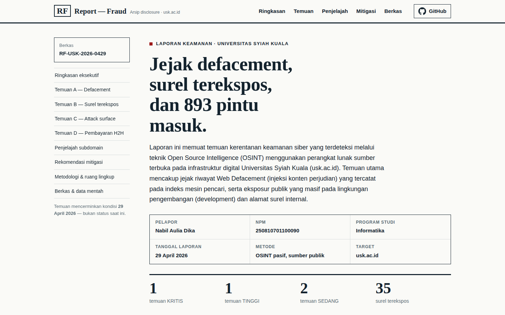
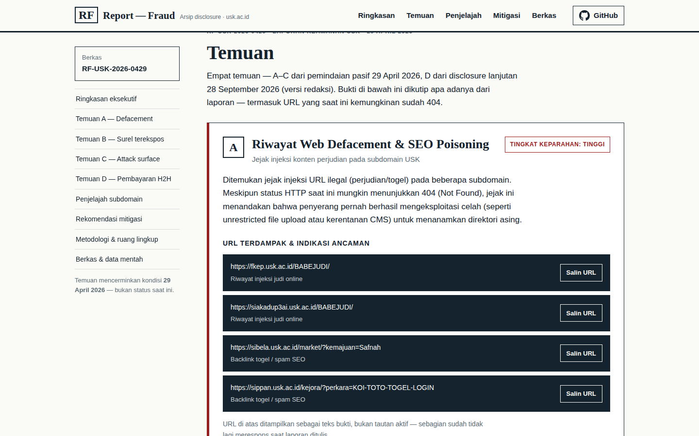
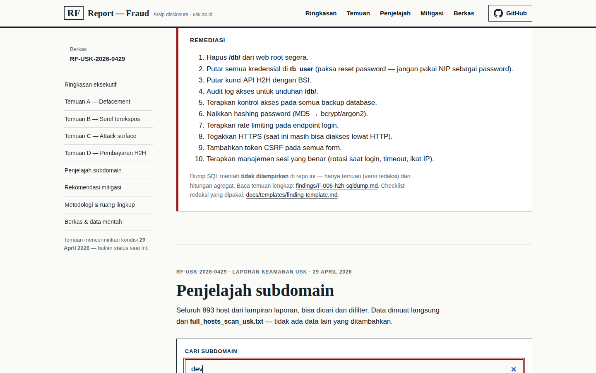
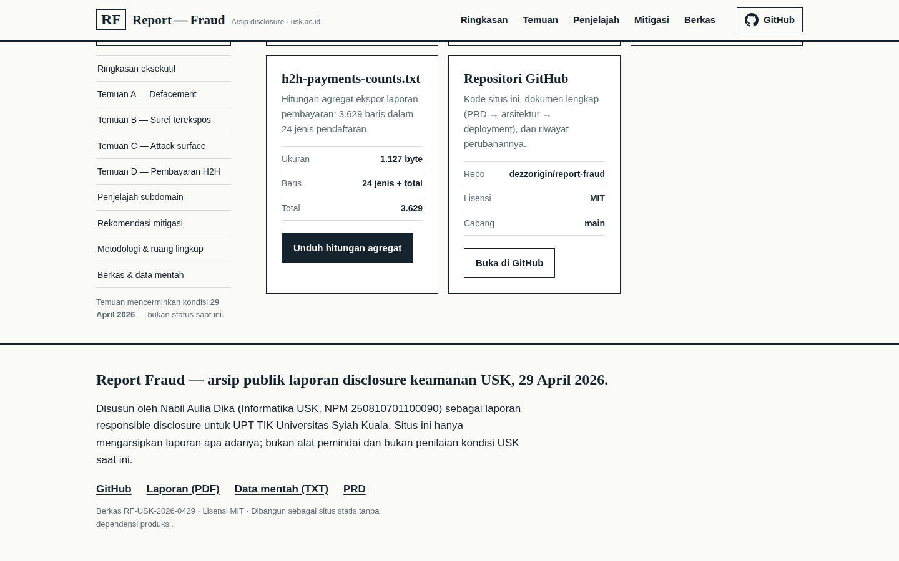

# Report Fraud — Laporan Keamanan USK 2026

Arsip publik laporan *responsible disclosure* keamanan Universitas Syiah
Kuala (29 April 2026): jejak defacement judi online, 35 surel terekspos,
dan 893 subdomain yang dipetakan secara pasif — disajikan sebagai situs
yang bisa dibaca, dicari, dan diverifikasi terhadap berkas aslinya.

**Live:** https://report-fraud.pages.dev/
**Repo:** https://github.com/dezzorigin/report-fraud



## Apa isinya

Pada 29 April 2026, Nabil Aulia Dika (Informatika USK) menyusun laporan
keamanan untuk UPT TIK Universitas Syiah Kuala dari pemindaian OSINT
pasif atas `usk.ac.id`. Situs ini mengarsipkan laporan itu apa adanya:

| Temuan | Keparahan | Isi |
|---|---|---|
| A — Riwayat Web Defacement & SEO Poisoning | **TINGGI** | Jejak injeksi judi online (`BABEJUDI/`) di `fkep.usk.ac.id` dan `siakadup3ai.usk.ac.id`, plus backlink togel di `sibela` dan `sippan` |
| B — Eksposur Data Publik | SEDANG | 35 alamat surel institusi fungsional terekspos (30 di @usk.ac.id, 5 di subdomain) |
| C — Pemetaan Subdomain / Attack Surface | SEDANG | 893 subdomain/host; aset berisiko tinggi `dev.fk.usk.ac.id` dan `perwaliandev.usk.ac.id` |

Plus 3 rekomendasi mitigasi (file auditing, pembatasan lingkungan
development, audit DNS) dan penjelajah 893 host yang bisa dicari dan
difilter.



## Penjelajah subdomain

Seluruh 893 host dari lampiran laporan, bisa dicari (`dev` → 6 host) dan
difilter per kategori (Dev & staging 6, Webmail 8, Mail 25, Fakultas 256,
Layanan 594, Lainnya 4). Data dimuat langsung dari
`full_hosts_scan_usk.txt` — satu sumber kebenaran, bukan salinan.



## Berkas asli

| Berkas | Isi |
|---|---|
| `Security_Disclosure_USK_2026.pdf` | Laporan utama (2 halaman, A4, 94.459 byte) |
| `full_hosts_scan_usk.txt` | Data mentah (979 baris: 35 surel, 17 alamat IP terhitung, 893 host) |

Kedua berkas dipindahkan byte-identik dari subfolder `unsyiah/` ke root
repo saat restructure (PR #1) — isinya tidak diubah.



## Video demo


Video walkthrough (hero → temuan → penjelajah → berkas), direkam dari
sistem live lokal. Lihat `docs/demo/demo.mp4`.

## Cara menjalankan lokal

Situs statis — tanpa build, tanpa dependensi produksi:

```bash
npm run serve        # http://127.0.0.1:8393
```

Pengujian (instalasi dependensi jalan di CI — `npm install` di VM dev
saat ini gagal deterministik, lihat `docs/testing.md` § "Batas VM dev"):

```bash
npx html-validate index.html
npm run validate     # gate P0 anti-slop + integritas data lampiran
python3 scripts/advisory-sweep.py   # OSV batch, 0 paket produksi
npx playwright test  # e2e desktop + mobile (CI)
npm run smoke        # smoke folder repo (persis yang di-deploy)
```

## Privasi & kejujuran data

- Alamat surel individual **tidak ditampilkan** di halaman ini — hanya
  agregat (35; 30 langsung + 5 subdomain). Daftar lengkap tetap ada di
  lampiran mentah untuk tim UPT TIK USK.
- Temuan mencerminkan kondisi **29 April 2026** — bukan status USK saat
  ini. Situs ini arsip, bukan alat pemindai, dan tidak menambah temuan
  baru.
- Header lampiran mengklaim 19 alamat IP server, tetapi Bagian 2 hanya
  memuat 17 baris. Selisih ini dicatat di `docs/API.md` dan bagian
  Metodologi — bukan dikoreksi diam-diam.

## Dokumentasi

- PRD: [`docs/PRD.md`](docs/PRD.md)
- Desain (referensi: Framler Security): [`docs/DESIGN.md`](docs/DESIGN.md)
- Arsitektur: [`docs/ARCHITECTURE.md`](docs/ARCHITECTURE.md)
- Kontrak data: [`docs/API.md`](docs/API.md)
- Diagram: [`docs/diagrams.html`](docs/diagrams.html)
- Deploy: [`docs/deploy.md`](docs/deploy.md)
- Pengujian: [`docs/testing.md`](docs/testing.md)

## Lisensi

MIT — lihat [LICENSE](./LICENSE).
